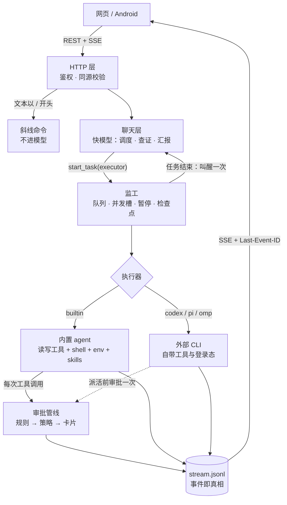

# reeve

**跑在自己电脑上的个人 AI 助理编排器**：聊天层说话，监工派活，执行器干活。一个 Go 二进制同时提供网页和 Android 客户端共用的 API；会话、日志与密钥都存在本机（对话内容会发送给你配置的模型渠道）。

[](https://github.com/kiry163/reeve/actions/workflows/ci.yml)
[](https://github.com/kiry163/reeve/actions/workflows/release.yml)
[](LICENSE)
[](go.mod)

[English](README.en.md)

## 这是什么

reeve 是一个装在**自己机器**上的助理平台，不连任何第三方 IM，也不依赖数据库：

- **双层模型**：聊天层（快模型）只负责理解、查证、派活、汇报，**没有执行权**；真正的读写文件与执行命令由监工调度的执行器完成。
- **危险的活要你点头**：默认审批策略 `untrusted`——只读放行，写文件与执行命令弹卡片等你批准；审批与具体那次调用绑定，不能挪用。
- **事件即真相**：每个 bot 一个追加写的 `stream.jsonl`，客户端用 SSE + `Last-Event-ID` 断线续传，内存状态在启动时由事件重放重建。
- **两个客户端，一套协议**：内嵌网页（React）与原生 Android（Kotlin + Compose），REST 写、SSE 读。
- **单二进制、单端口**：HTTP API、SSE、网页、上传下载都走同一个监听；没有数据库、没有消息队列、没有 Web 框架。

## 特性

| 能力 | 说明 |
|---|---|
| 多 bot | 每个 bot 独立工作区、记忆、密钥、环境变量、模型、定时计划；上限 32 个 |
| 执行器 | 内置 agent（任意 OpenAI 兼容模型）为默认，可显式切到 `codex` / `pi` / `omp` 外部 CLI |
| 审批 | 规则 → 策略 → 卡片；一次批准绑定单次调用，同一任务内相同参数可复用 |
| 环境变量 | 三层（实例 / bot / 调用），模型可读、写入留审计；密钥不进这三层 |
| 密钥库 | AES-256-GCM 加密，模型只看到占位符，输出统一脱敏 |
| 技能 | 本地 `SKILL.md` 索引进系统提示，正文按需读取 |
| 斜线命令 | 服务端解析，**不进模型上下文**：`/help` `/stop` `/clear` `/model` `/agent` `/env` `/skills` `/context` `/tasks` `/approve` |
| 定时计划 | 每个 bot 自己的计划（单次 / 每天 / 每周），到点派活 |
| 常驻服务 | macOS launchd / Linux systemd `--user`，`reeve service install` 一条命令装好 |

## 架构



## 快速开始

需要 **Go 1.22+**；构建网页还需要 **Node.js 22.18+**（CI 用 24，`npm test` 依赖 Node 的类型擦除）。

```bash
git clone https://github.com/kiry163/reeve.git
cd reeve

make build        # 构建前端 + 打包成 bin/reeve
./bin/reeve serve # 前台启动，默认只监听 127.0.0.1:18800
```

启动后会打印网页地址（默认 <http://127.0.0.1:18800/>）并尝试打开浏览器。首次启动自动生成访问 token（`~/.reeve/token`，`0600`）；**本机回环访问免认证**。

只装了 Go 工具链也可以构建，但控制台会没有界面（前端是构建时嵌进去的）：

```bash
go build ./cmd/reeve
```

接一个模型：打开网页 → 设置 → API 渠道 → 填 OpenAI 兼容的 Base URL、模型名与 API Key。

### 连手机

```bash
./bin/reeve serve -addr 0.0.0.0:18800   # 让局域网可达（没有 TLS，只限可信网络）
./bin/reeve pair                        # 打印配对串：reeve://pair?v=1&host=…&token=…
```

配对串可以粘贴进 Android 客户端，或自己转成二维码再扫。客户端构建与连接细节见 [docs/android.md](docs/android.md)。

### 装成常驻服务

```bash
./bin/reeve service install    # macOS launchd / Linux systemd --user，不需要 sudo
./bin/reeve service status
./bin/reeve service uninstall
```

服务定义只设 `REEVE_HOME` 与 `PATH`，**不会自动对外监听**；要让手机直连，按 [docs/service.md](docs/service.md) 在服务定义里加 `REEVE_ADDR`。

## 命令行

| 命令 | 作用 |
|---|---|
| `reeve` / `reeve serve` | 启动 HTTP + SSE + 网页（`-addr` 指定监听地址） |
| `reeve pair` | 打印手机连接用的地址与配对串 |
| `reeve token show` | 打印当前 token |
| `reeve token rotate` | 轮换 token，所有已登录设备立即失效 |
| `reeve service install\|uninstall\|status` | 安装/卸载/查询用户级常驻服务 |
| `reeve version` | 版本信息 |

## 环境变量

| 变量 | 默认 | 说明 |
|---|---|---|
| `REEVE_HOME` | `~/.reeve` | 数据目录：token、`master.key`、每个 bot 的事件日志与工作区 |
| `REEVE_ADDR` | `127.0.0.1:18800` | 监听地址（等价于 `serve -addr`） |
| `REEVE_MASTER_KEY` | 读 `$REEVE_HOME/master.key` | 密钥库主密钥；也可由外部注入 |
| `WEB_DIR` | 内嵌前端 | 指向一个目录以覆盖网页资源（开发时用） |

## 目录结构

```
cmd/reeve/            入口与子命令（serve / pair / token / service / version）
cmd/fakeai/           冒烟测试用的假模型服务
internal/bot/store.go 事件日志、启动重放、SSE 广播与游标补发
internal/bot/         聊天层、监工、任务、审批、定时、记忆、bot 注册表、人设
internal/exec/        外部执行器契约；internal/exec/cli/ 是 codex / pi / omp 适配器
internal/builtin/     内置 agent 循环、工具注册表、上下文压缩
internal/envstore/    三层环境变量、合并顺序、校验
internal/envx/        从子进程环境里剔除密钥与厂商 Key
internal/scheduler/   定时计划（单次 / 每天 / 每周）与派发
internal/atomicfile/  原子写文件
internal/vault/       密钥库（AES-256-GCM、占位符替换、输出脱敏）
internal/skills/      SKILL.md 扫描与索引
internal/commands/    斜线命令注册表与执行
internal/auth/        token、Cookie 会话、限速
internal/service/     launchd / systemd 服务定义生成与安装
web/                  React 网页（构建产物嵌入二进制）
android/              Kotlin + Compose 客户端
```

## 开发

```bash
make help          # 列出所有目标
make build         # 前端 + Go，产物 bin/reeve
make test          # Go + 前端 + Android 单测
make test-go       # 只跑 Go
make test-web      # 只跑前端
make test-android  # 只跑 Android 单测（需 JAVA_HOME / ANDROID_HOME）
make lint          # gofmt 一致性 + go vet + 前端 typecheck
make apk           # debug APK
make release VERSION=X.Y.Z  # 正式发布（四平台 + SHA256SUMS，见 docs/release.md）
```

Android 目标的工具链配置见 [docs/android.md](docs/android.md)；Android 的单测与 debug 构建在 CI 里每次提交都跑。

## 文档

| 文档 | 内容 |
|---|---|
| [docs/android.md](docs/android.md) | Android 客户端构建、连接、功能与手工验证记录 |
| [docs/android-contract.md](docs/android-contract.md) | 客户端契约：端点、事件、状态、限制 |
| [docs/service.md](docs/service.md) | 安装为常驻服务（launchd / systemd）与已知边界 |
| [docs/release.md](docs/release.md) | 发布脚本、产物命名、GitHub Release 与签名 |
| [CHANGELOG.md](CHANGELOG.md) | 版本变更 |
| [docs/superpowers/specs](docs/superpowers/specs/2026-11-14-reeve-design.md) | 设计文档与取舍 |

## 已知限制

- **没有沙箱**：执行器以你的用户身份读写本机文件；安全压力全部落在审批上。要更强的隔离，请用外部执行器或容器。
- **没有 TLS**：明文 HTTP，请只在可信局域网使用；跨网络用 Tailscale 或 SSH 隧道。
- **单用户**：没有多租户、注册、权限隔离；不适合直接暴露到公网。
- **平台**：服务安装只支持 macOS 与 Linux；Windows 目前只能前台 `serve`。
- **无系统推送**：Android 靠前台服务保活 + 本地通知，进程被系统回收后不会主动送达。
- **不做**：MCP、provider fallback 链、旧版本数据迁移、iOS/桌面客户端。

## 许可

[MIT](LICENSE) © 2026 kiry163
