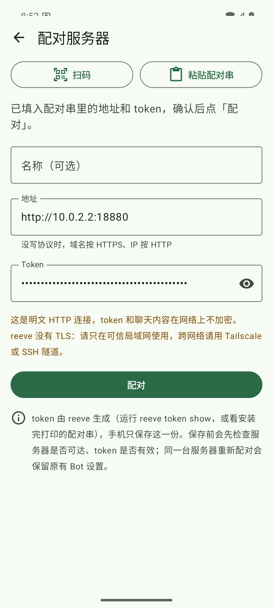
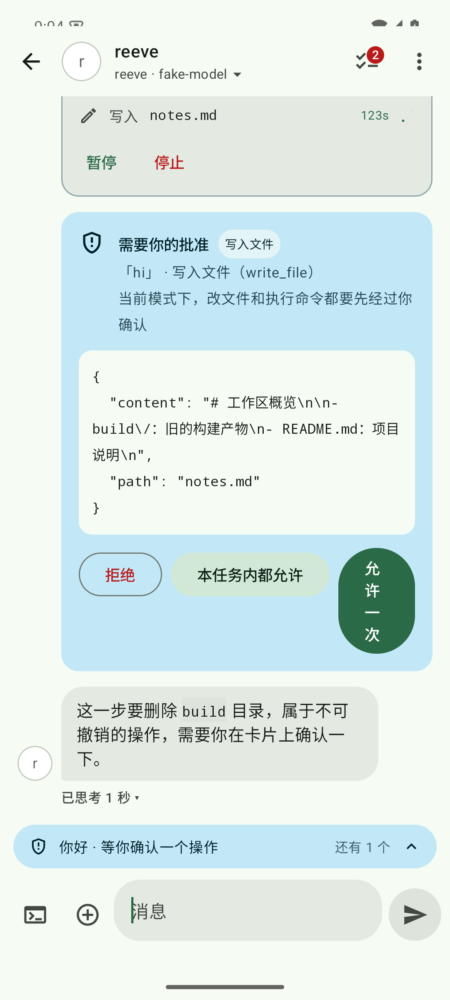
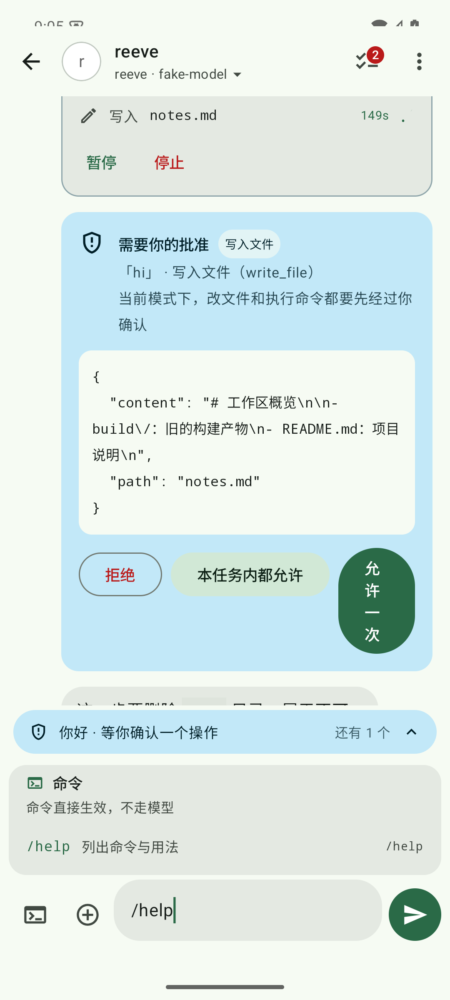
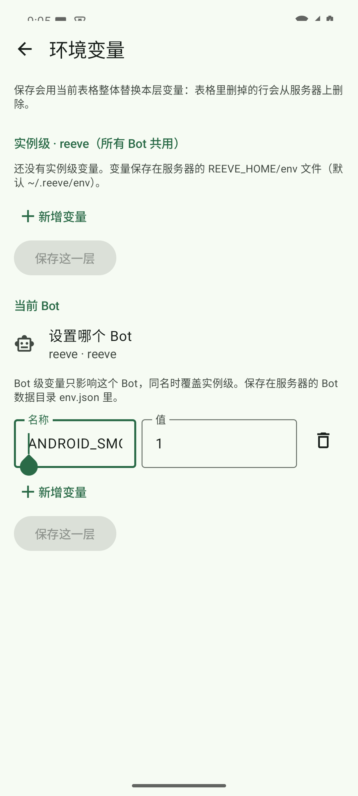

# Android 客户端

reeve 的原生 Android 客户端：Kotlin + Jetpack Compose（Material 3），包名 `dev.reeve.app`，
`minSdk 26`（Android 8.0）、`targetSdk 35`。它连一台或多台 reeve 服务器，用密码登录换来的
设备会话令牌认证，通过 SSE 事件流（`Last-Event-ID` 断线续传）归并出聊天、任务与审批状态，
不依赖网页端。

客户端源码在 `android/`，实现依据是 [`android-contract.md`](android-contract.md)。

## 构建 APK

需要 JDK 17+ 与 Android SDK（`platforms;android-35`、`build-tools;35.0.0`）。

调试包（用 AGP 的 debug 密钥签名，只用于测试）：

```bash
cd android
JAVA_HOME=/opt/homebrew/opt/openjdk@17 \
ANDROID_HOME=/path/to/Android/sdk \
  ./gradlew --no-daemon :app:assembleDebug
# 产物：app/build/outputs/apk/debug/app-debug.apk
# 当前在 android/ 目录
adb install -r app/build/outputs/apk/debug/app-debug.apk
```

正式包：

```bash
cd android
REEVE_ANDROID_KEYSTORE=/path/to/reeve.p12 \
REEVE_ANDROID_KEYSTORE_PASSWORD=… \
REEVE_ANDROID_KEY_ALIAS=reeve \
REEVE_ANDROID_KEY_PASSWORD=… \
JAVA_HOME=/opt/homebrew/opt/openjdk@17 ANDROID_HOME=/path/to/Android/sdk \
  ./gradlew --no-daemon :app:assembleRelease -PreeveVersion=0.4.0
# 产物：app/build/outputs/apk/release/app-release.apk
```

没有 `REEVE_ANDROID_KEYSTORE` 时 release 构建**保持未签名**（`app-release-unsigned.apk`），
不会回退到 debug 密钥；`scripts/release.sh` 在没有签名配置时直接跳过 APK。签名密钥必须是固定的
PKCS#12 文件，换密钥会导致无法覆盖安装。`-PreeveVersion` 默认为 `0.0.0`，
`versionCode = max(1, major*1_000_000 + minor*1_000 + patch)`（所以默认 `0.0.0` 时实际是 1）。

单元测试（JVM，不需要模拟器）：

```bash
cd android
JAVA_HOME=/opt/homebrew/opt/openjdk@17 ANDROID_HOME=/path/to/Android/sdk \
  ./gradlew --no-daemon :app:testDebugUnitTest
```

## 连接服务器

服务端监听一个手机能访问到的地址（默认只监听回环）：

```bash
REEVE_HOME=~/.reeve ./reeve serve -addr 0.0.0.0:18880
```

配对串的格式固定为：

```
reeve://pair?v=1&host=<地址>[:端口]
```

- `<地址>` 可以写 `IP:端口`、`localhost:端口` 或域名。没写协议时，IP / localhost 按 `http://`，
  其它域名按 `https://`。
- 服务器首次启动时会生成随机初始密码并只打印一次；之后可用网页「设置 › 账号与登录」或
  服务器上的 `reeve passwd` 修改。配对串**不包含密码**，手机登录时只保存服务器签发的设备会话。
- 配对页提供三种输入：扫码（扫内容是配对串的二维码）、粘贴配对串、手填地址。服务端不渲染二维码；
  用任意二维码工具把配对串生成二维码即可。扫码/粘贴只填地址，密码需要自己输入。
- 点「登录并保存」前会先 `GET /api/health` 确认地址可达且确实是 reeve（`ok=true` 且 `api_version`
  非空，普通 HTTP 服务会提示「这个地址不像 reeve 服务器」），再用密码 `POST /api/auth/login`
  换取设备会话，最后 `GET /api/auth/me` 确认；同一个 `host:端口` 重新登录会复用原条目并保留 Bot 偏好。
- **外部链接来源确认**：任何 App / 网页都能触发 `reeve://pair`。深链打开的配对页顶部会显示
  「这些信息来自外部链接，不是你扫码得到的」和**完整地址**，未勾选「我已核对地址」时「登录并保存」
  按钮禁用；扫码、粘贴配对串、手填不显示这条提示。密码始终由用户输入，不会出现在深链或二维码里。
- **备份已关闭**：`android:allowBackup="false"`。设备会话令牌存在明文 `SharedPreferences` 里，因此
  App 不进云备份，也不能用 `adb backup` 导出数据。

### 模拟器（Android Emulator）

模拟器里的 `10.0.2.2` 指向宿主机的回环地址，所以服务端监听 `0.0.0.0:18880` 时可以直接用
`10.0.2.2:18880`。启动模拟器后安装并打开深链：

```bash
# 在仓库根执行
adb install -r android/app/build/outputs/apk/debug/app-debug.apk
adb shell 'am start -a android.intent.action.VIEW -d "reeve://pair?v=1&host=10.0.2.2:18880"'
```

深链**只预填地址**，不会自动保存；输入服务器密码后点「登录并保存」。上面这条 `am start` 必须
整条放进 `adb shell '…'` 的引号里：URL 里的 `&` 会被设备 shell 当成后台运算符，命令在第一个 `&`
处就被截断，配对页只剩前半段地址。

### 真机

手机与服务器在同一可信局域网时：

1. 服务端用 `-addr 0.0.0.0:18880` 启动（日志会提示非回环、无 TLS）。
2. 查服务器局域网 IP（如 `192.168.1.20`），在服务器上运行
   `reeve pair --addr 192.168.1.20:18880` 得到配对地址；首次启动打印的初始密码用于登录，
   也可以用 `reeve passwd` 先设好。
3. 手机上点开配对串（分享/通知里点链接）、扫码，或在「设置 › 添加服务器」里粘贴/手填地址，
   然后输入服务器密码。
4. 跨网络不要直接暴露端口：用 Tailscale 或 SSH 隧道，把手机能访问到的地址填进配对串。

reeve 没有 TLS：HTTP 明文里的登录密码、设备会话令牌与聊天内容在局域网上不加密，App 会在配对页与
服务器列表里标出「HTTP 未加密」。只在可信网络使用。

## 功能清单

- **配对与服务器管理**：扫码 / 粘贴配对串 / 手填 / 深链预填；多台服务器并存，每台独立设备会话与
  Bot 列表；登录过期（30 天）或改密后提示重新输入密码。
- **聊天**：用户消息、助手流式回复（`chat.delta`）、思考与工具调用的折叠卡片、notice 行（命令结果、
  任务事件摘要）、文件卡片、任务卡片（暂停/停止/继续/重试/下一个做）、审批卡片（允许一次 / 本任务内都允许 / 拒绝）、
  附件上传、换聊天模型、重新生成、停止全部任务。
- **命令面板**：输入 `/` 弹出候选（`/help`、`/stop`、`/clear`、`/model`、`/agent`、`/env`、`/skills`、
  `/context`、`/tasks`、`/approve`）；选中候选只会把命令回填到输入框，再按发送才执行。
  命令直接生效、不走模型，结果以居中 notice 行显示在聊天里。
- **设置**：
  - 环境变量：只有实例级（所有 Bot 共用），整表保存；`/env list` 只显示变量名，值显示为 `<已隐藏>`。
  - 执行器：外部 CLI 白名单（内置执行器始终可用）、默认执行器、每个外部 CLI 的模型/认证选项，可重新检测安装状态。
  - 技能：显示服务器加载的技能索引（名称、描述、何时使用、相对路径），只能查看。
  - 通知：是否使用 ntfy 外部推送，以及 App 内本地通知的三类开关。
  - 自动审批：实例级 shell 命令白名单在网页「设置 › 自动审批」维护，Android 端不提供入口；
    保存后立即对所有 Bot 生效。
  - 外观：跟随系统 / 浅色 / 深色。
- **推送（ntfy）**：
  - 服务端在网页「设置 › 推送」里配置自建 ntfy 的地址、topic、认证方式（无 / 访问 token /
    用户名 + 密码）和三类事件开关，可发送测试通知。token 和密码都加密存储，网页不会回显。
  - 手机安装 ntfy（F-Droid 或 GitHub 上不带 FCM 的构建），订阅 `ntfy://<host>/<topic>`，
    授予通知权限并关闭电池优化；国产 ROM 还需要允许自启动。如果 ntfy 开了访问控制，
    在 App 里填同一个 token 或用户名密码。
  - App 打开「设置 › 通知 › 使用 ntfy 外部推送」后，App 内不再弹本地通知。服务端在审批请求、
    任务终态和助手最终回复时推一条极简通知；点击通过 `reeve://open?bot=…&host=…` 打开对应聊天。
  - `public_host` 要和 App 里配置的服务器地址一致（host[:port]）；不填时点击只打开 App，
    不定位聊天（多台服务器时无法判断）。
  - 不依赖 FCM/Google。ntfy App 被系统杀掉或未给电池白名单时，通知会延迟或丢失；
    App 打开后仍会按 `Last-Event-ID` 补齐事件。
- **本地通知**（关闭外部推送时）：审批走 `alerts` 渠道，任务终态与新回复走 `replies` 渠道；
  正在看该 Bot 的任意页面（且 App 在前台）时不打扰。通知是 `VISIBILITY_PRIVATE`，锁屏公开版本
  只有 Bot 名（不含摘要、服务器名或会话令牌）。点击通知先进入不导出的透明 `RouteActivity`，由它把
  `serverId|botId` 放进进程内状态再拉起 `MainActivity`；外部 App 不能注入 ref。外部推送的点击是
  单独的 `reeve://open`，只导航到已配置的服务器，不读取任何凭据。进程被杀后点通知重建仍会打开对应聊天。

## 手工验证记录（2026-11-16）

环境：macOS arm64，Android Emulator 37.2.13，`system-images;android-35;google_apis;arm64-v8a`
（Pixel 6，1080×2400），服务端为仓库当前提交构建的 `reeve`，模型用 `cmd/fakeai`
（`127.0.0.1:9911`，`fake-model`）。服务端数据目录是 `mktemp -d` 生成的临时目录，
模拟器访问宿主机用 `10.0.2.2:18880`。

| # | 验证项 | 结果 |
|---|---|---|
| 1 | 深链配对 → 会话列表出现 `main` | ok |
| 2 | 发「你好」→ 助手流式回复 | ok |
| 3 | `/help` → 候选 → 执行 → 居中 notice | ok |
| 4 | 设置加环境变量 → 保存 → `/env list` 可见且隐藏值 | ok |
| 5 | 执行器勾选 `omp` → 默认改为 omp → 重新进入仍为 omp | ok（已验证白名单与默认执行器持久化；派活徽标未验证） |
| 6 | 放 `skills/demo/SKILL.md` 并重启服务 → 技能列表出现 demo | ok |
| 7 | 后台任务完成 → 通知 → 点击进入对应聊天 | ok |
| 8 | 杀服务 → 重连提示 → 恢复后按 `Last-Event-ID` 续传 | ok |
| 9 | 深链打开配对页 → 外部链接提示 + 完整地址、未勾选时「登录并保存」禁用 | ok |
| 10 | 设置 › 添加服务器（非深链来源）→ 无外部链接提示与勾选 | ok |
| 11 | 后台任务完成 → 通知 → 点击进入对应聊天（先经 `RouteActivity`） | ok |
| 12 | 杀进程后再点任务通知 → 冷启动打开对应聊天 | ok |
| 13 | 锁屏公开版本只有 Bot 名；`dumpsys notification` 显示 `vis=PRIVATE` 且摘要不在公开版本 | ok |



配对串通过深链打开后，配对页预填 `http://10.0.2.2:18880`，输入服务器密码并点「登录并保存」；
登录成功后回到会话列表，出现 Bot `reeve`（会话 id 为 `main`）。



发「你好」后助手回复先以 `chat.delta` 增量到达（同一时段抓到的 SSE 里共有 15 条
`kind: "chat.delta"`，文本逐段增长），随后 fakeai 的剧本派了一个任务并请求写入文件的审批。
聊天页同时显示助手文本、思考折叠条与审批卡片。



输入 `/help` 弹出候选（`/help — 列出命令与用法`），选中后按发送执行；结果以居中 notice 行显示
10 条命令与用法，`stream.jsonl` 里对应一条 `command.result`，没有新增用户消息。



在「设置 › 服务器 › 环境变量」的实例级表格里新增 `ANDROID_SMOKE=1` 并保存，服务端 `GET /api/env`
返回 `{"vars":{"ANDROID_SMOKE":"1"}}`；聊天里执行 `/env list` 的 notice 内容为：

```
实例级（所有 Bot 共享）：
  ANDROID_SMOKE  <已隐藏>
值请在设置的「环境变量」里查看。
```

### 其余观察（原始输出）

执行器：勾选 `omp`（宿主 PATH 中已安装）并把默认执行器切到 omp，保存后
`GET /api/bots/main/executors` 返回
`{"allowed":["builtin","omp"],"default":"omp"}`，`GET /api/bots/main/info` 的 `agent_cli` 变为 `omp`；
退出并重新进入执行器页，勾选与默认项保持，且因没有改动，保存按钮处于禁用状态。
（后续为了跑通 fakeai 的内置任务，又把默认执行器切回 `builtin`，白名单仍保留 `omp`。）

技能：服务端启动后写入 `$REEVE_HOME/skills/demo/SKILL.md`，重启服务，
`GET /api/bots/main/skills` 返回
`{"skills":[{"name":"demo","description":"模拟器验证用的示例技能",…,"path":"skills/demo/SKILL.md"}]}`；
「设置 › 技能」显示 `demo`、描述、何时使用与相对路径，底部为「共 1 个技能。」。

通知：把 App 切到后台后用 API 批准任务，任务完成后通知栏出现
`reeve / 任务「world」完成了`（`replies` 渠道，`dumpsys notification` 可见），点击后
`topResumedActivity=dev.reeve.app/.MainActivity`，打开的是该 Bot 的聊天，任务卡片与结果都在。

重连：杀掉监听 18880 的 reeve 进程后，聊天顶部出现
「正在重新连接「reeve」，已开始的任务会继续运行」。为了看到客户端重连请求带上的
`Last-Event-ID`，恢复时把服务端起在 `127.0.0.1:18882`，并在 18880 放一个只做透传、记录请求头的
临时反向代理（约 20 行 Go 的 `httputil.ReverseProxy`，未进仓库）；App 仍访问
`10.0.2.2:18880`，代理日志记录到：

```
GET /api/bots/main/stream last-event-id="81" ua="okhttp/4.12.0"
```

随后在服务端执行 `/context`，新产生的 `command.result`（seq 82）实时出现在聊天里，旧消息没有重复。
完整原始输出见 `.superpowers/sdd/2026-11-16-reeve-m4a-android/task-11-report.md` 第 8 项。
服务端直连 18880 时重连行为相同，代理只透传并记录请求头。

### 未在设备上验证

以下功能菜单已在代码与单元测试里覆盖，但本次没有在模拟器/真机上逐项操作：

- 扫码、粘贴配对串、手填三种配对入口（只走了深链预填后的「登录并保存」按钮；模拟器无相机）；
- 真机通过局域网 IP 连接（只在模拟器用 `10.0.2.2`）；
- 附件上传、密钥卡片（secrets）、多服务器切换、Bot 编辑页；
- 外部执行器 `omp` 真正派活后的执行器徽标与流式输出（只验证了白名单与默认执行器持久化）；
- 拒绝通知权限后的行为；
- ntfy 外部推送的端到端记录（网页配置 → 杀掉 App → 收到通知 → 点击打开对应聊天）尚未加入本表。

## 已知限制

- **推送依赖 ntfy App**：服务端只负责把通知发到自建 ntfy；手机端 ntfy App 被系统杀掉、没有电池白名单
  或网络不可达时，通知会延迟或丢失。App 打开后仍会按 `Last-Event-ID` 补齐事件。
- **不再后台保活 SSE**：前台保活服务已移除；只有 App 存活/打开时才保持事件流。关闭外部推送时，
  进程被系统回收后不会主动送达通知。
- **不自动更新**：App 自身不检查新版本、不下载 APK，需要手动安装新包（必须用同一签名密钥）；
  设置里的「检查更新」查的是**服务端**的 `/api/update`（reeve 二进制版本），与手机上的 App 版本无关。
- **不迁移旧数据**：只保存本机的服务器列表（地址 + 设备会话）与偏好，不导入网页端或其它客户端的
  本地数据；换机需要重新登录。
- **审批通知不会自动撤销**：审批在别处（网页端）处理掉、或任务在 App 里取消之后，之前发出的通知
  仍留在通知栏，需要点开或手动划掉；ntfy 通知同样不会自动撤销。
- **本地通知同类只保留最新一条**：同一 Bot 连发两条新回复时，后一条覆盖前一条，历史都在聊天页里；
  ntfy 通知由 ntfy App 管理，可能堆叠。
- **明文 HTTP**：没有 TLS，登录密码、设备会话令牌与聊天内容在网络上不加密；只适合可信局域网或
  Tailscale/SSH 隧道。
- **外部执行器没有沙箱**：勾选外部 CLI 等于把整台机器的执行权交给它；内置执行器的审批策略
  也不构成文件系统隔离（工作区只是约定目录）。
- **服务端重启会中断执行中的任务**：客户端断线重连后事件会按 `Last-Event-ID` 续传，但如果是 reeve
  进程本身重启，当时正在运行或等待审批的任务会以 `context canceled` 结束（验证时确实如此）；
  聊天顶部的「已开始的任务会继续运行」只描述客户端断网的情况，需要重新派活。
- 最低支持 Android 8.0（API 26）。Android 13+ 每次创建 Activity 都会请求通知权限；已授权时系统直接返回、
  不弹框，只在首次（或用户撤销后）才会出现权限对话框。
