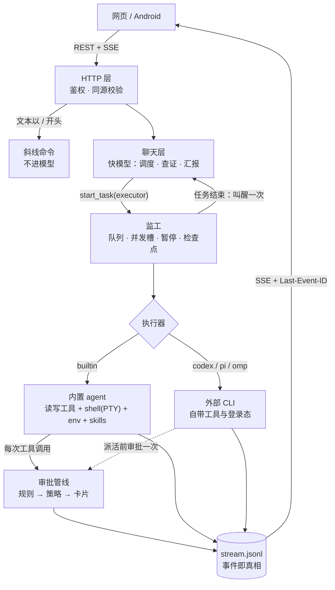

# reeve 设计

> 状态：待评审 · 2026-11-14
> 定位：跑在自己 Mac 上的个人助理编排器。聊天层说话，监工派活，执行器干活；手机随时派活、审批、看进度。

## 1. 设计取向

reeve 的编排骨架来自两代个人助理实现的取舍：前代验证了单 agent loop 的局限，也留下了 PTY 执行、三层环境变量、斜线命令与 `SKILL.md` 这些能力；基线实现验证了聊天层 + 监工 + 执行器、事件溯源与审批绑定更适合长期运行的个人助理。reeve 继承后者的编排与客户端协议，吸收前者的执行能力，但不把两代的历史包袱带进来。

| 取舍 | 结论 |
|---|---|
| 编排 | 聊天层 + 监工 + 执行器，事件溯源 |
| 执行 | 内置 agent 为默认，可插拔外部 CLI |
| 客户端 | 网页 + Android，共用 REST + SSE |
| 明确不做 | 沙箱、提权、IM、MCP、多用户、TLS、系统推送、旧数据迁移 |

## 2. 目标

1. 本机常驻：在 macOS 上以 launchd 用户服务运行，数据全部在 `~/.reeve`。
2. 双层执行模型：聊天层永不阻塞、永不亲自动手；执行权只属于执行器。
3. 多 bot：每个 bot 独立工作区、记忆、密钥、环境变量、模型、定时计划；v1 上限 32 个（固定值，不做成可配置项）。
4. 网页 + Android 两个客户端，共用一套 REST + SSE 协议。
5. 执行器可插拔：内置 agent 为默认，codex / pi / omp 为显式升级。
6. 可见的环境变量：实例级与 bot 级模型可读（`list_env`），调用级由 `shell` 的 `env` 参数按次注入；写入逐条记审计事件，模型发起的写入按审批策略判定，用户命令直接生效。
7. 密钥与普通变量严格分家：模型永远看不到密钥明文。
8. 斜线命令：服务端解析，不进模型上下文。
9. 技能：本地 `SKILL.md`，索引进系统提示，正文按需读取。

## 3. 非目标（v1 明确不做）

不做沙箱；不做 root 提权；不做 Linux/Windows 服务；不做服务器模式（远程登录、多用户、权限隔离）；不做公网暴露与 TLS；不做 IM 通道（telegram/qq/feishu/weixin 全部移除）；不做 MCP；不做在线技能市场与安装器；不做 iOS/桌面客户端；不做系统级推送（FCM/APNs）；不做 provider fallback 链；不做多设备互联/relay；不做旧数据迁移（旧版本数据不读）。

## 4. 决策记录

| # | 决策 | 依据 |
|---|---|---|
| 1 | 本机优先，默认只监听回环 | 使用场景是自己的 Mac |
| 2 | 不做沙箱、不做 root 提权 | 明确取舍；安全压力转移到审批 |
| 3 | 默认审批策略 `untrusted`（只读放行，写/执行弹卡） | 没有沙箱时这是唯一护栏 |
| 4 | 内置执行器为默认，外部执行器需显式指定并在 bot 白名单内 | 外部 CLI 内部命令无法逐条拦截 |
| 5 | 聊天层只读、只调度，不写文件、不跑命令、不能批准 | 双层模型的核心约束 |
| 6 | 环境变量三层，密钥不进这三层 | 差异化能力 |
| 7 | 客户端只要网页 + Android | 明确取舍 |
| 8 | 名字 `reeve`，独立仓库 | 明确取舍 |

## 5. 命名与标识符

| 标识 | 值 |
|---|---|
| module | `github.com/kiry163/reeve` |
| 二进制 / 命令 | `reeve` |
| 数据目录 | `~/.reeve`（`REEVE_HOME` 覆盖；`REEVE_CONFIG` 覆盖配置路径） |
| 主密钥 | `REEVE_MASTER_KEY`（可注入，缺省时用 `data/master.key`） |
| 默认监听 | `127.0.0.1:18800` |
| macOS 服务名 | `io.reeve.agent` |
| 配对 URL | `reeve://pair?v=1&host=<addr>&token=<token>` |

端口选 18800 是为了避开常用的本机开发端口（8080–8099、18790）。

## 6. 架构



单二进制、单端口：HTTP API、SSE、内嵌网页、上传下载都走同一个监听。没有数据库；每个 bot 一个 `stream.jsonl` 作为唯一真相，内存状态在启动时由事件重放构建。

### 6.1 代码布局

```
cmd/reeve/            入口与子命令（serve / pair / token / service / version）
internal/store/       事件日志、重放、SSE 广播与游标补发
internal/bot/         聊天层、监工、任务、审批、定时、记忆、bot 注册表、人设
internal/exec/        执行器接口与注册表；适配器 builtin / codex / pi / omp
internal/builtin/     内置 agent 循环、工具注册表、上下文压缩
internal/envstore/    三层环境变量、合并顺序、校验
internal/vault/       密钥库（AES-256-GCM、占位符替换、输出脱敏）
internal/skills/      SKILL.md 扫描与索引
internal/commands/    斜线命令注册表与执行
internal/auth/        token、Cookie 会话、限速
web/                  React 网页（构建产物嵌入二进制）
android/              Kotlin + Compose 客户端
```

依赖只保留标准库与 `golang.org/x/crypto`（bcrypt 可选）；不引入 Web 框架、路由器、日志库。

## 7. 状态：事件即真相

- 持久化事件写入 `data/bots/<id>/stream.jsonl`，单写者、追加、每行一条 JSON，含单调递增 `seq`。
- `seq > 0` 持久化并推送；`seq = 0` 临时事件（流式文字、输入中）只推送不落盘。
- `internal: true` 的事件只给后端，不下发客户端。
- 客户端重连带 `Last-Event-ID`（或 `?after=<seq>`）补发；补发结束发送 `replay.done`。
- 写进日志与推送之前统一过脱敏函数（密钥、已知 token）。
- 启动时按 bot 重放：消息、任务状态、审批决定、定时计划、环境变量改动全部恢复。

事件类型（v1 全集，新增需改本节）：

| 事件 | 含义 |
|---|---|
| `message` | 用户/助手/通知消息（含 `tools`、`thinking`、`files`、`card`、`secret` 字段） |
| `message.state` | 消息状态迁移（pending/handled/replied） |
| `message.hidden` | 消息被“重新生成/编辑重发”替换 |
| `message.reaction` | 表情回应 |
| `task.created` / `task.updated` | 任务创建与状态变更（queued/running/paused/done/failed/interrupted） |
| `task.note` | 任务内的中间备注（卡死、方向变更） |
| `task.summary` / `task.reported` | 任务收尾摘要、已汇报标记 |
| `task.prio` | 优先级调整 |
| `approval.request` / `approval.record` | 审批请求与决定 |
| `env.set` / `env.unset` | bot 级环境变量变更（含来源：user/chat/builtin；**不记值**） |
| `executors.updated` | 执行器白名单/默认执行器变更（`allowed`、`default`） |
| `executors.dropped` | 启动读取配置时丢弃了当前版本不认识的 kind（`kinds`） |
| `secret.card` | 密钥卡片状态（永不包含值） |
| `command.result` | 斜线命令的输出 |
| `card` | `ask_user` 选项卡片状态 |

> 兼容性（M3）：任务记录里的执行器字段为 `executor`；M2 及更早日志里的 `cli` 不再读取（升级后这些旧的外部任务按内置执行器处理）。

## 8. 执行器契约

执行器是唯一有执行权的东西。接口只有事件流，没有返回值语义。`Kind` 有四个值
（`builtin | codex | pi | omp`），但只有后者三个实现 `Runner`；内置执行器有自己的 Agent 循环，
不在这层接口里。

```go
type Runner interface {
    Kind() Kind
    Available(ctx context.Context) error // 二进制存在 + `--version` 能解析出版本号（不查登录态）
    Start(ctx context.Context, req Request, sink Sink) (Handle, error)
}

type Request struct {
    TaskID, BotID, Workspace string
    Input                    string        // 任务原文（含暂停期间补充的备注）
    Instructions             string        // 追加说明（密钥清单、Bot 职责）
    History                  []string      // 已渲染的上下文（"[role]\ncontent"）
    Env                      []string      // 三层合并后的环境（不含 reeve 自身凭据）
    Model                    string        // CLI 自己的模型名；空 = CLI 默认
    MaxDuration              time.Duration // 监工侧兜底超时（omp 另收 --max-time）
}

type Handle interface {
    Pause(ctx context.Context) error
    Resume(ctx context.Context) error
    Stop(ctx context.Context) error
    Done() <-chan Result
}

type Result struct {
    Status      string // completed | failed | cancelled
    Output      string
    Error       string
    Interrupted bool // 被 Stop 打断（停机中断判定用）
}
```

`Sink` 只接受四类事件：`text`（流式文字）、`tool`（工具调用开始）、`tool_result`（调用结果）、
`heartbeat`（进程仍活着）。**没有 checkpoint**：外部 CLI 没有可续跑的内部快照，暂停/恢复靠
`SIGSTOP`/`SIGCONT` 保留进程本身，进程没了就只能中断后重派。

### 8.1 三个实现的行为差异

| | builtin | codex / pi / omp |
|---|---|---|
| 工具来源 | 内置注册表 | CLI 自带 |
| 审批 | 每次写/执行逐条弹卡 | 派活前一次；内部命令不审 |
| 暂停 | 两步之间的安全点，未开始的步骤可取消 | `SIGSTOP` 进程组（等价于挂起） |
| 恢复 | 从检查点继续 | `SIGCONT` |
| 停止 | 取消上下文，等在跑的工具结束 | 先 `SIGTERM` 进程组，5 秒后 `SIGKILL` |
| 重启后 | 有检查点，可手动或自动恢复 | 标记 `interrupted`，不自动重跑 |
| 模型凭证 | 设备级渠道池（密钥加密） | 用自己的登录态；`gateway: true` 时走本机网关（v1 只对 pi 实现） |
| 环境变量 | 完整注入（三层） | 完整注入（三层） |

适配器的启动参数与输出解析必须依据各 CLI 当版的 `--help` 实测确定，spec 只固定接口、失败语义与环境注入方式。实现时每个适配器附一段“实测记录”（版本、命令、样例行），写在对应源码文件顶部注释里。

### 8.2 白名单

每个 bot 配置 `executors.allowed`，默认 `["builtin"]`。聊天层只能把任务派给白名单内的执行器；白名单外的请求直接报错，不弹卡片。白名单变更只能由用户在设置页（`PUT /api/executors`）或 `/agent` 命令里直接操作，**模型没有修改白名单的工具**；保存时仍会校验「必须包含 builtin、默认执行器必须在白名单内、kind 必须已注册」。

### 8.3 实现状态（M3 收尾）

- 白名单、派活前一次审批、进程组暂停/恢复/终止均已落地。白名单外派活直接返回错误文案，不弹卡、不写 `task.created`；外部派活在批准前也不写 `task.created`。审批参数带执行器、任务 hash、短标题和正文前 400 个字符的预览（只给人看；完整正文不进审批参数）。逐条实测见 `docs/smoke-m3.md`。
- 派活审批只覆盖**聊天层派活**：没有聊天模型时，用户消息直接进任务队列（用户就是发起人，白名单是唯一闸门，不弹卡）。`retry` 是用户点击，沿用原任务的执行器（空 = builtin）且不再弹卡，但会按当前白名单重新校验；执行器已被移出白名单时拒绝重试。定时计划固定派生内置任务（`Executor=""`）：到点触发没有人守着审批卡片，计划不接受外部执行器；`POST /api/schedules/{id}/run` 同样如此。
- 外部执行器的运行中/暂停中任务**不支持插话**：`steer_task` 返回「外部执行器运行中无法插话；要改要求请取消后重新派一次，或在暂停后继续（补充不会转达）」，不写 `task.note`；`resume_task` 的 `note` 也只如实说明没有转达（外部 CLI 的输入在启动时就固定了）。
- `Available` 只回答「二进制存在 + `--version` 能解析出版本号」，不检查登录态或模型可用性。`GET /api/settings/connections` 会起子进程探测并缓存结果；`?probe=0` 只刷新安装状态与缓存，不起子进程。响应里的 `probed` 是独立字段：`probed=false`（未探测且无缓存、或尚未安装）时 `available` 不构成结论，客户端只在 `probed=true && available=false` 时判不可用。执行期的鉴权、网络错误由任务 `failed` 事件如实呈现。
- Windows 没有 `SIGSTOP`/`SIGCONT`，也没有能发给进程组的 TERM：用户暂停/恢复返回「该执行器在 Windows 上不支持挂起，请用停止代替」并保持原状态，终止用 `taskkill /T /F` 结束整棵树；监工卡死又挂不住时直接终止并落 `failed`（文案「长时间没有进展，且当前平台不支持挂起，已终止」）。
- 正常停机（reeve 收到 `SIGTERM`）会把运行中的外部任务按 `SIGTERM` → 5 秒 → `SIGKILL` 收尾，但记录落 `paused(interrupted)`（停机不是用户取消，不写 `cancelled`、不汇报），下次启动 `recover()` 对已是 `paused(interrupted)` 的记录幂等跳过，不自动重跑；只有用户主动取消才落 `cancelled`。判定用 `Result.Interrupted && 正在停机`：`Interrupted` 由 CLI 适配器在「被 Stop 打断」时置位；`StopReason=user` 的任务在任何状态下都不被停机改写。异常退出（`SIGKILL`、断电）同样在下次启动被标成 `paused(interrupted)`。内置任务停机仍按取消收尾。

## 9. 聊天层

职责：理解需求、查证事实、派活、汇报。**没有执行权**。

| 工具 | 风险 | 说明 |
|---|---|---|
| `list_tasks` / `read_task` / `search_history` | read | 看任务与历史 |
| `start_task` / `queue_task` / `pause_task` / `resume_task` / `cancel_task` / `reprioritize` / `steer_task` | write | 派活与调度（`queue_task(hold=true)` 记成待办） |
| `read_file` / `list_dir` / `search_files` | read | 只读浏览工作区 |
| `list_env` | read | 看实例级与 bot 级变量名与值（密钥不在其中；调用级只在单次 shell 调用内存活，不进模型上下文） |
| `list_secrets` / `request_secret` / `delete_secret` | read / write | 只能用名字；删除需审批 |
| `read_skill` | read | 读取技能正文；技能列表用 `/skills` 命令或 `GET /api/bots/{id}/skills`，不占模型上下文 |
| `memory_read` / `memory_write` | read / write | 长期记忆 |
| `list_schedules` / `create_schedule` / `update_schedule` / `pause_schedule` / `resume_schedule` / `delete_schedule` / `run_schedule_now` | read / write | 定时计划；写需审批 |
| `ask_user` / `react` / `current_time` | read | 交互 |

聊天层的工具边界：**去掉 `write_file` / `edit_file`**。聊天层不改文件；小改动也走任务。

一轮对话的语义：

- 把当前未处理的消息合并为一次调用；先说话再调工具时，先说的话立刻作为独立消息发出（不用等工具）。
- 聊天层上下文 = 最近 30 条消息 + 全部未处理消息；超出则丢最旧的整轮（不拆工具调用与结果）。
- 流式文字走 `seq=0` 事件；落盘只写最终消息。
- 用户说“停/停止/取消”由代码直接处理，不进模型。
- 任务结束、审批有了决定、密钥已保存等系统提示以 `notice` 消息唤醒，且每个结果只汇报一次。
- 模型调用失败（网络、鉴权、超时）：写一条 `notice` 说明失败原因，待处理消息**保持未处理**，用户重发或点重试即重新进入一轮；不吞掉用户输入，不自动重试。

## 10. 监工

纯 Go，不调模型。

| 机制 | 规则 |
|---|---|
| 并发 | 全局 `max_concurrent` 默认 3；没抢到空位进入等待，任何任务结束重新排队 |
| 队列 | 按 `prio`（默认创建时间）升序；`reprioritize` 直接改值 |
| 暂停 | 内置：两步之间检查（正在执行的工具一定跑完，正在进行的模型请求直接取消）；外部：`SIGSTOP` |
| 暂停期间的并发槽 | 外部任务的进程还活着、只是挂起，并发槽继续占着（不是泄漏）；恢复时 `SIGCONT` 从原处接着跑，不会重起进程 |
| 检查点 | 内置每步结束写 `data/bots/<id>/checkpoints/<task>.json`（消息数组、迭代号、用量） |
| 卡死 | 内置：90 秒没有任何事件；外部：10 分钟没有任何**输出**（文字、工具调用、工具结果）——心跳只证明进程活着，模型思考几分钟很正常，不算进展。命中后记 `task.note` + `task.pausing{stall}` 并暂停：内置在安全点，外部直接 `SIGSTOP` 进程组，等用户决定 |
| 超时 | 单任务默认 30 分钟：内置由任务上下文取消；外部由监工 `AfterFunc` 兜底（omp 另外收 `--max-time`），到点 `SIGTERM`/`SIGKILL` 并落 `failed`，文案「超过 N 分钟没有完成，已终止」。**暂停期间停表**：SIGSTOP 挂起时记下剩余时间，恢复（SIGCONT）后接着计，挂多久都不算进超时 |
| 重启恢复 | 运行中/排队中的任务 → `paused`：内置标 `restart`（有检查点，可继续）；外部标 `interrupted`（进程随上次退出一起没了，不自动重跑）；`held` 待办保持 `held` |
| 汇报 | 任务落终态时给聊天层一条 `notice`；`task.reported` 保证只报一次 |

心跳与进度是两件事：`Proc` 每 15 秒发的心跳只刷新 `LastActivity`（证明进程还在），`LastProgress` 只由输出更新；外部卡死检测看后者。挂起进程失败时不能假装暂停（不存在“状态暂停、进程还在跑”的记录）：平台不支持信号（Windows）时，用户主动暂停直接返回错误「该执行器在 Windows 上不支持挂起，请用停止代替」且不改状态；监工卡死又挂不住则直接 `Stop()` 终止进程并落 `failed`，文案「长时间没有进展，且当前平台不支持挂起，已终止」。其他失败撤掉 `pausing`、任务继续跑。落 `paused(stall)` 前在同一把 `sch.mu` 下复核任务仍在运行，避免和取消的 TERM→KILL 宽限期交错。

明确不做：重启时不清理上次遗留的外部 CLI 进程组（§16.1.1）；`interrupted` 的界面文案由网页侧跟进，不在监工范围内。

## 11. 审批

### 11.1 策略

只有三档（不实现未落地的 `auto` 审核模型）：

| 策略 | 行为 |
|---|---|
| `untrusted`（默认） | 只读自动放行；写、执行、删除、改 env、改白名单、外部派活一律弹卡 |
| `on-request` | 工作区内的写与普通命令自动放行；出工作区、提权类命令、改配置仍弹卡 |
| `never` | 只读放行，其余一律拒绝（不弹卡） |

### 11.2 绑定与判定

一次批准记录包含 `task + tool + args_hash`（SHA-256，规范化 JSON）。聊天里说“同意”不产生批准；只有 `POST /api/approvals/{id}` 或 `/approve <id> allow` 能产生。批准 `scope=once` 只能用一次，`scope=session` 在本任务内对同样参数的调用有效，任务结束即失效。

### 11.3 风险分级

| 操作 | 等级 |
|---|---|
| 读文件、列目录、搜索、`list_env`、`list_secrets` | read |
| 写/删文件、`set_env`、`memory_write`、改定时 | write |
| `shell`、外部派活 | exec |
| 删除密钥、修改主配置、改执行器白名单 | danger（任何策略下都必须用户作答；`never` 下直接拒绝）。执行器白名单不是聊天层工具：只能由用户在设置页或 `/agent` 直接操作，所以它不产生审批卡片 |

审批请求与决定都写进事件日志；进程重启后未决请求保留，可由任一客户端作答。审批本身不设超时（本机常驻，用户可能过几小时才看手机）；任务超时或取消时，该任务全部未决审批立刻作废，卡片显示“任务已结束”，之后作答返回 409。

## 12. 环境变量

三层，优先级由低到高：实例级与 bot 级在派活时合并进执行器环境，调用级在 `shell` 执行前叠加到这份列表上，不落盘。

| 层 | 存储 | 修改者 | 注入时机 |
|---|---|---|---|
| 实例级 | `data/env`（0600，`KEY=VALUE` 每行） | 网页/`/env set --global` | 每次派活时合并进执行器环境；不修改主进程自身环境 |
| bot 级 | `data/bots/<id>/env.json` | 网页、`/env set`、内置 agent 的 `set_env`（审批） | 每次派活前合并 |
| 调用级 | `shell` 工具参数 `env: {"K":"V"}`（不存储） | 内置 agent | 仅本次命令生效，执行前叠加，`PATH` 前置到低层 `PATH` 之前 |

规则：

- 合并顺序 实例 < bot < 调用；`PATH` 特例：三层做**前置拼接**（`调用:bot:实例:继承`），不覆盖。
- 值为空字符串表示“显式清空该变量”，不会被下层补回。
- 名字必须匹配 `^[A-Za-z_][A-Za-z0-9_]*$`，长度 ≤ 128，值不含换行与 NUL。
- bot 级变更逐条写 `env.set` / `env.unset` 事件，含来源（user / chat / builtin），可审计；事件只记变量名与来源，**不记值**（值可能含代理凭据），界面通过 `GET /api/bots/{id}/env` 读取。
- 聊天层只能读（`list_env`）。用户命令（`/env set`、`/env unset`）直接生效，用户就是授权者；模型发起的 `set_env` / `unset_env` 在 `untrusted` 下弹卡，在 `on-request` 下按 write 策略判定（见 §11 与 §14）。
- 疑似密钥的值（高熵、匹配常见 token 前缀）写入 bot 级时给出警告，但允许保存——用户可能确实要明文变量。

注入实现：通过 `exec.Cmd.Env` 数组传入，不拼接 shell 字符串；调用级由 `envstore.Overlay` 在 `exec` 前合并，与其它层共用同一套名字/值校验（`{{secret:…}}` 与换行一律拒绝，校验失败则不执行命令）；`shell` 工具用 `env -i` 只在本机非交互场景按需启用，默认保留继承环境。

## 13. 密钥

- 存量：`data/secrets.json`（AES-256-GCM），主密钥来自 `REEVE_MASTER_KEY` 或 `data/master.key`（0600，首次启动生成）。
- 模型与事件里只允许出现 `{{secret:NAME}}`；`NAME` 匹配 `^[A-Z][A-Z0-9_]{0,63}$`，保留名（`PATH`、`HOME`、`SHELL`、`LD_PRELOAD`、`NODE_OPTIONS` 等）禁止使用。
- 替换发生在工具执行前一刻；`shell` 里密钥以环境变量 `${NAME}` 形式存在。
- 输出脱敏覆盖明文、base64、URL 编码、hex 四种形态；脱敏在写事件日志之前。
- 密钥永不进入三层环境变量的存储、事件、模型上下文或错误信息。
- 密钥卡片只显示名字与状态；值由客户端 `POST /api/secrets` 直接提交。

## 14. 斜线命令

解析在 HTTP 入口、进聊天层之前。命中命令时：不写消息、不叫醒聊天层、不进入上下文；结果作为 `command.result` 事件落盘并推送。未知命令返回可用命令列表，不交给模型。

| 命令 | 作用 | 审批 |
|---|---|---|
| `/help` | 列出命令与用法 | — |
| `/stop` | 停止所有任务与当前回复 | — |
| `/clear` | 清空当前会话上下文（旧消息标 hidden，开新 generation） | — |
| `/model [name]` | 查看/切换当前 bot 的聊天模型 | 用户命令直接生效（用户即授权者） |
| `/agent [list\|<kind>]`（别名 `ex`） | 查看/切换默认执行器（`list` 只列白名单；受白名单限制） | 用户命令直接生效 |
| `/env [list\|set K=V\|unset K] [--global]` | 查看/修改环境变量 | 用户命令直接生效；模型发起的 `set_env` 需审批 |
| `/skills` | 列出可用技能 | — |
| `/context` | 上下文用量（消息数、估算 token、压缩阈值） | — |
| `/tasks` | 任务摘要（运行/排队/暂停/完成） | — |
| `/approve <id> allow\|deny` | 命令行作答审批（与卡片等价，仍绑定 args_hash） | — |

命令实现为注册表（名字、别名、参数说明、handler），供 `/help` 与网页命令面板共用一套定义。

## 15. 技能

- 位置：`data/skills/<name>/SKILL.md`（全局）、`data/bots/<id>/skills/<name>/SKILL.md`（bot 私有，优先）。
- 格式：YAML frontmatter 必填 `name`、`description`、`when_to_use`；正文为操作步骤。
- 注入策略：系统提示只放 `name — description — when_to_use` 三列索引；正文由 `read_skill(name)` 按需读取。不引入 BM25 检索（YAGNI）。
- 加载失败（frontmatter 不合法、重名、正文为空）逐个报错并跳过，不影响启动。
- 不做在线安装、仓库搜索、版本管理。

## 16. HTTP 与客户端

### 16.1 认证

- 首次启动生成 `data/token`（32 字节随机，base64url，0600）。
- 回环地址免认证固定为开（M1）。`auth.loopback_free` 开关与 `config.json` 加载器推迟到 M2：M1 只用 flag/env 配置，回环免认证不可关。
- 非回环必须带 `Authorization: Bearer` 或会话 Cookie；网页用 token 换 Cookie（`reeve_session`，HMAC 签名，7 天）。
- 监听地址非回环且 token 未就绪时**拒绝启动**（fail closed）。
- `reeve pair` 打印控制台地址与配对串 `reeve://pair?v=1&host=<addr>&token=<token>`；二维码由 Android 端在 M4 生成，服务端不引入渲染依赖。
- `reeve token rotate` 轮换 token，所有会话立即失效。
- 没有 TLS：文档与启动日志明确提示仅限可信局域网，跨网络请用 Tailscale 或 SSH 隧道。写请求校验 `Origin` 与 `Host` 同源。

### 16.1.1 已知边界

回环免认证是为了让本机客户端（网页、命令行、`reeve pair`）不用每次带 token，代价是**本机任何进程**都能无 token 调本地 API——包括内置执行器里由 `shell` 跑起来的命令。这不构成新的隔离边界：执行器本来就拥有整机执行权，它完全可以自己读 `data/token` 再带认证调 API；回环免认证只是省掉了这一步。要限制本机进程，得靠系统级隔离（独立用户、容器、沙箱），不在本项目范围内。§18 的“工作区只是约定目录”说的是同一件事。

另一条边界：重启恢复**不清理**上次留下的外部 CLI 进程组（`recover()` 只改任务状态，不 `kill` 孤儿进程）。reeve 被强杀时，被 SIGSTOP 挂起的 `codex`/`pi`/`omp` 进程组可能还留在机器上，需要用户自己 `ps`/`kill`；反过来，如果新实例去发信号，也可能误伤同 PID 复用的无关进程。所以这条留给系统级手段（会话/终端回收、cgroup、容器），不在应用层处理。

### 16.2 端点

沿用既有编排结构的形状，新增 env / executors / commands / skills：

| 端点 | 用途 |
|---|---|
| `GET /api/health` | 公开健康检查（ok、version、api_version） |
| `POST /api/auth/token` `GET /api/auth/me` | 会话（token 换 Cookie） |
| `GET /api/bots` `POST /api/bots` `PATCH /api/bots/{id}` `DELETE /api/bots/{id}` | bot 管理 |
| `GET /api/bots/{id}/stream` | SSE，支持 `Last-Event-ID` 与 `?after=` |
| `POST /api/bots/{id}/messages` | 发送文本/附件；以 `/` 开头按命令处理 |
| `POST /api/bots/{id}/uploads` `GET /api/bots/{id}/files?path=` | 附件与工作区文件 |
| `POST /api/bots/{id}/tasks/{id}/{action}` | pause / resume / cancel / reprioritize |
| `POST /api/bots/{id}/approvals/{id}` | 作答审批 |
| `POST /api/bots/{id}/cards/{id}` | 作答 `ask_user` 卡片 |
| `GET /api/bots/{id}/schedules` `POST /api/bots/{id}/schedules/{id}/{action}` | 定时计划 |
| `GET/PUT /api/env` `GET/PUT /api/bots/{id}/env` | 实例级 / bot 级环境变量 |
| `GET/PUT /api/bots/{id}/executors` | 执行器白名单与默认执行器 |
| `GET /api/commands` `POST /api/bots/{id}/commands` | 命令列表与执行 |
| `GET /api/bots/{id}/skills` | 技能索引（只读；bot scope，`path` 为 `skills/<目录>/SKILL.md` 相对标签） |
| `GET /api/settings` `POST /api/settings` `GET/POST /api/channels` | 模型渠道与模型选择 |
| `GET /api/capabilities` | 版本、上传上限、命令表版本 |

约定：JSON 写入前校验完整对象与大小（默认 1 MiB）；附件单文件 25 MiB、每次 16 个；SSE 每 20 秒心跳。

### 16.3 Android

复用既有客户端骨架（REST + SSE + 前台服务保活），不做系统推送：常驻通知让进程与 SSE 活着，待审批与任务完成用本地通知提醒。改动集中在设置页（env、执行器、技能索引）与新增命令面板。

## 17. 数据布局

```
~/.reeve/
  config.json              版本、监听、策略、渠道池、bot 索引
  token                    0600
  master.key               0600
  env                      实例级环境变量
  secrets.json             加密密钥库
  skills/<name>/SKILL.md   全局技能
  bots/<id>/
    settings.json          人设、模型、执行器白名单、审批策略
    env.json               bot 级环境变量
    memory.md              记忆
    stream.jsonl           事件日志
    checkpoints/<task>.json
    workspace/             执行器工作目录
    skills/<name>/SKILL.md
  tools/                   由 reeve 安装的外部 CLI 与 node（可选）
  logs/
```

> 注（M1 实现）：上表是最终形态。M1 默认 Bot 的数据目录直接就是 `REEVE_HOME`（事件日志在 `$REEVE_HOME/stream.jsonl`，检查点在 `$REEVE_HOME/checkpoints/`），只有非默认 Bot 才在 `bots/<id>/` 下。`config.json` 加载器推迟到 M2。

备份 = 整个目录；`master.key` 与 `secrets.json` 同目录意味着备份文件本身就是敏感数据。

## 18. 安全模型

没有沙箱，所以规则必须简单且可复述：

1. 默认只监听回环，跨设备访问必须持 token。
2. 默认 `untrusted`：任何写与执行都要人点头。
3. 批准绑定参数哈希，聊天内容不能代替按钮。
4. 密钥不进模型上下文，输出进日志前脱敏。
5. bot 的工作区只是约定目录，不是隔离边界——这一点在文档与界面上明说，不制造虚假安全感。
6. 外部执行器等于“把整台机器的执行权临时交给那个 CLI”，所以必须显式列入白名单并逐次派活批准。

## 19. 保留与重写清单

保留的既有实现（改造后继续用）：

| 模块 | 处理 |
|---|---|
| `internal/bot/store.go` | 保留事件溯源与 SSE 补发，加 `env.set` / `command.result` 两类事件 |
| `internal/bot/supervisor.go` | 保留队列/并发槽/暂停/检查点；外部执行器的暂停改为进程信号 |
| `internal/bot/chat.go` | 保留双层提示与调度工具；删掉 `write_file`/`edit_file` |
| `internal/builtin/approval.go` | 保留三层判定与 args_hash；删掉 `auto`/审核模型分支 |
| `internal/builtin/agent.go` + `compact.go` | 作为 `internal/builtin` 的循环与压缩 |
| `internal/builtin/tools.go` | 换成 reeve 工具集（`shell` 用独立 PTY 实现） |
| `internal/exec/cli/` | 外部适配器基础设施 |
| `internal/vault` `internal/auth` `internal/scheduler` | 原样保留 |
| `web/` `android/` | 保留骨架，改设置页与命令面板 |

删除：`internal/sandbox`（613 行）、`internal/rootd`（683 行）、`internal/bot/devices.go` / `peer_http.go` / `relay.go`（1,037 行）、Windows / macOS / iOS 客户端（24,605 行）、把 `codex` 等 CLI 排除在外的 `SupportedCLI` 门禁（适配器改为按注册表启用，codex / pi / omp 三个都实现）。

从前代实现重写进新结构：

| 能力 | 落到 reeve |
|---|---|
| PTY 与后台会话（`list/poll/read/write/send-keys/kill`，1 MiB 环形缓冲，30 分钟回收） | `internal/builtin` 的会话管理 |
| 环境变量白名单导入（`PATH`/`TZ`/`LANG`/`LC_*`/代理/TLS） | `internal/envx` |
| 斜线命令注册表形态（名字/别名/handler/共用定义） | `internal/commands` |
| `SKILL.md` 加载与校验 | `internal/skills` |
| launchd 服务安装与日志 | `internal/service` |

## 20. 测试策略

- 单元（表驱动）：审批策略矩阵与 args_hash 绑定、三层 env 合并与校验、命令解析、事件重放的确定性、SSE 游标边界。
- 集成（`httptest` + 假模型 + 假 CLI 脚本）：从 `POST /messages` 到 SSE 收到完整事件序列；覆盖派活、审批允许/拒绝、暂停/恢复、重启后恢复、外部执行器超时被杀。
- 竞态：`go test -race ./...`。
- 不写 UI 自动化；Android 用手工验证清单（配对、SSE 断线重连、审批通知、命令面板）。

## 21. 里程碑

| 阶段 | 交付 |
|---|---|
| M1 骨架 | 裁剪后的服务端可启动：事件日志、bot 注册表、审批、任务队列、内置执行器（读/写/编辑/shell）跑通；网页可对话与审批 |
| M2 环境与命令 | 三层 env、vault 边界、斜线命令、`reeve service install`（launchd） |
| M3 外部执行器 | codex / pi / omp 适配器、白名单、派活前审批、进程组暂停与终止 |
| M4 技能与客户端 | skills 索引与 `read_skill`、Android 端适配（配对、命令面板、设置页）、发布脚本 |
